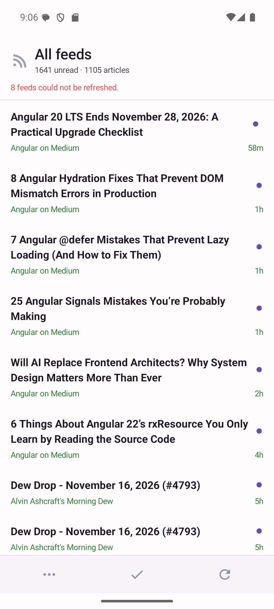
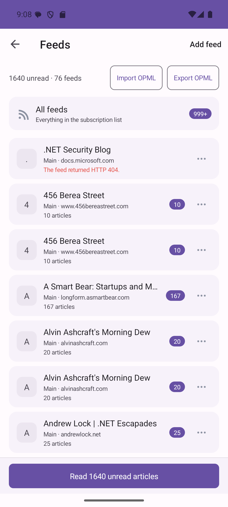

# Android RSS Reader

[](https://dotnet.microsoft.com/)
[](https://learn.microsoft.com/dotnet/maui)
[](https://developer.android.com/)

A native Android reader for RSS and Atom feeds, written in C# with .NET 11 and .NET MAUI.

No account, no server, no tracking: subscriptions and articles live on the phone, so the list of
articles is on screen as soon as the app starts and stays readable without a connection. Feeds are
imported from an OPML file (or added one by one by their address), which makes the app a drop-in
replacement for whatever reader you are using today.

| Reader | Feeds |
|:---:|:---:|
|  |  |

## Features

### Reading

- One flat list of articles from all feeds, newest first — articles are interleaved by their own
  publication time instead of being grouped per feed.
- Opens on the **unread** articles. The menu switches between *show unread only* and *show read and
  unread*.
- Tap an article to open it in the browser. It is marked as read but **stays in the list**, drawn in
  a light grey, so you can see what you have just read. Rows disappear only when you mark them as
  read.
- Mark everything as read with one tap (current feed or all feeds), with a confirmation prompt.
- Pick a single subscription on the Feeds page to read only that one, or tap *All feeds* to go back
  to the combined list.
- Pull down to refresh, the bottom refresh button fetches the latest articles and always returns to
  the unread list, and the reader downloads on its own when it was opened more than 10 minutes ago.

### Subscriptions

- **Import OPML** through the Android file picker. Folder outlines become folder names, duplicates
  are skipped, and the feeds are listed immediately while their articles download in the background.
- **Export OPML** writes the whole subscription list to an OPML 2.0 file and hands it to the Android
  share sheet (Drive, Gmail, Quick Share, Bluetooth, other readers…).
- **Add feed** by address: the feed is downloaded and validated first, so a mistyped address or an
  HTML page is rejected instead of being stored. Title and website are taken from the document.
- Per-feed menu (⋮): *mark as read*, *copy feed address*, *edit feed address*, *remove feed*.
- **Edit feed address** also downloads before saving and keeps the title and folder. When the new
  address already belongs to another subscription, the app offers to merge the two rows into one.
- The list is sorted alphabetically by feed title, with the unread count and last error of every
  feed shown inline.

### Fetching and robustness

- Supports **RSS 2.0**, **RSS 1.0 (RDF)** and **Atom**, including `guid`/`id`, `pubDate`,
  `published`, `updated` and `dc:date`, and the weekday-prefixed date variants some blogs emit.
- Legacy encodings are handled (UTF-8 with or without BOM, UTF-16, Windows-1252, ISO-8859-1 and
  whatever the XML declaration names), because many older feeds are not UTF-8.
- Four downloads in parallel, 20 second timeout, 10 MB per document, at most 200 entries per feed
  kept in the cache, the newest 50 of each shown in the reader.
- A feed that fails does not stop the refresh: the others are stored and the failure is reported
  under the title of the feed that broke, while the previously downloaded articles of the broken
  feed stay readable.
- Relative links are resolved against the feed address, so entries without absolute URLs still open.
- Article identifiers are derived from the feed address and the entry identifier, so read state
  survives refreshes and restarts.

## Requirements

- [.NET SDK 11](https://dotnet.microsoft.com/download) with the .NET MAUI Android workload:

  ```powershell
  dotnet workload install maui-android
  ```

- The Android SDK with the API 37 platform and build tools (the versions this project is built
  against).
- An Android device or emulator running **Android 7.0 (API 24)** or newer. The minimum is API 24
  because .NET 11 no longer supports Android 5.0/6.0.
- Windows or macOS as the build host.

## Building

```powershell
dotnet restore
dotnet build -c Debug -f net11.0-android
dotnet build -c Release -f net11.0-android
```

The APKs end up in:

- `AndroidRssReader\bin\Debug\net11.0-android\com.companyname.androidrssreader-Signed.apk`
- `AndroidRssReader\bin\Release\net11.0-android\com.companyname.androidrssreader-Signed.apk`

Install one on a connected device or running emulator:

```powershell
adb install -r AndroidRssReader\bin\Debug\net11.0-android\com.companyname.androidrssreader-Signed.apk
```

Debug builds embed the assemblies into the APK (`EmbedAssembliesIntoApk`), so the app starts
standalone without Fast Deployment. The Release APK is not signed with a release key; create your
own keystore before publishing to a store.

## Project layout

| Path | Contents |
| --- | --- |
| `Models/` | `FeedSubscription`, `Feed`, `Article`, `FeedContent` and the OPML import/export results |
| `Services/FeedClient.cs` | Downloads a feed and parses RSS, RDF and Atom into articles |
| `Services/FeedService.cs` | The single entry point for the UI: refresh, filtering, read state, add/edit/remove |
| `Services/FeedStore.cs` | Subscription list (`feeds.json`) |
| `Services/ArticleCacheStore.cs` | Downloaded articles (`articles.json`) |
| `Services/ReadStateStore.cs` | Read flags by article id (`read-state.json`) |
| `Services/OpmlParser.cs`, `OpmlImporter.cs` | OPML reading and the file picker |
| `Services/OpmlDocument.cs`, `OpmlExporter.cs` | OPML 2.0 writing and the share sheet |
| `Services/ReaderSettings.cs` | Filter and feed selection, stored with `Preferences` |
| `ViewModels/MainViewModel.cs` | The reader: article list, refresh, mark as read |
| `ViewModels/FeedsViewModel.cs` | The Feeds page: list, import/export, add/edit/remove, counters |
| `Views/` | Shell, reader page, feeds page and the feed address dialog |
| `Resources/` | Material 3 colours and styles, icons, fonts, app icon and splash screen |
| `docs/` | Screenshots used by this README |

## How it works

`FeedClient` fetches a document and turns it into `FeedContent`; `FeedService` decides what gets
downloaded, keeps the three JSON stores in sync and answers the queries the pages make
(`GetFeedsAsync`, `GetArticlesAsync`, `RefreshFeedsAsync`). The view models only hold UI state and
never touch HTTP or files directly; the pages are XAML over those view models, and a small service
locator (`Services/AppServices.cs`) hands the shared instances to them because Shell creates the
pages itself.

The reader renders the cached articles first and only then refreshes, which is why opening the app
never shows a spinner over an empty screen. Downloads run behind a semaphore so a refresh cannot be
started twice, and every subscription action cancels a running refresh so import, export and edits
react immediately.

## Data and privacy

- Everything is stored in the app's private directory (`FileSystem.AppDataDirectory`) as
  `feeds.json`, `articles.json` and `read-state.json`; the settings live in Android `Preferences`.
  Nothing is uploaded anywhere, there are no analytics and no third-party SDKs.
- Uninstalling the app removes the data. OPML export is the way to take the subscription list with
  you; read state is not exported.
- The manifest allows cleartext traffic (`android:usesCleartextTraffic="true"`) so blogs that only
  serve `http://` can be subscribed. Remove that attribute from
  `Platforms/Android/AndroidManifest.xml` for an HTTPS-only build.

## Known limitations

- No scheduled background sync: feeds are refreshed when the app is opened (at most every 10
  minutes) and on demand. There is no push, so a new article shows up the next time you open the
  reader or pull down.
- The "opened but still listed" rows are a per-session convenience; after a cold start the unread
  list shows only the articles that are still unread.
- Headlines only: images, enclosures, podcast audio and full-text extraction are not implemented,
  and there is no search.
- Phone layout only (single window, pages via Shell); no tablet-specific layout.
- The application id is still the .NET MAUI template one (`com.companyname.androidrssreader`).
  Changing it turns the app into a separate installation, so it was deliberately left alone.

## Contributing

Issues and pull requests are welcome. Please keep the build warning free
(`dotnet build -c Debug -f net11.0-android`), match the existing style (nullable reference types
enabled, one service per concern, XML comments on non-obvious members) and avoid adding UI packages —
the app deliberately uses plain .NET MAUI controls.

## License

Released under the MIT license, see [LICENSE](LICENSE).
